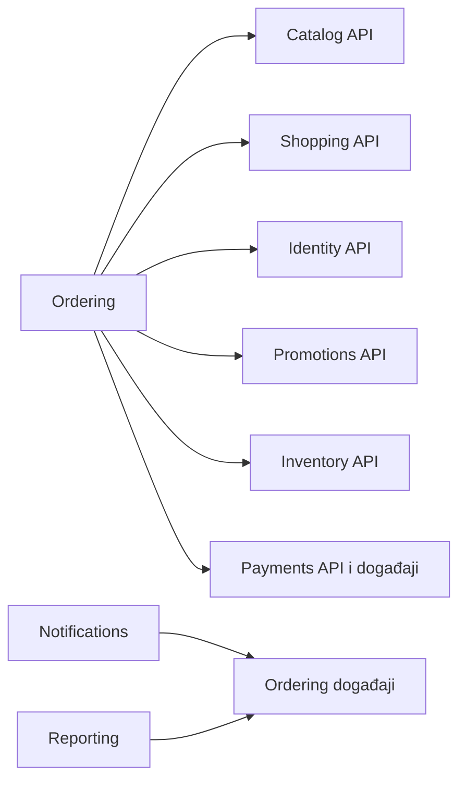

# NoPressure Wear: organizacija modularnog monolita

## 1. Preporuka i cilj

Za ovaj projekat preporučujem jednu Spring Boot aplikaciju, jedan proces i jednu PostgreSQL bazu, ali sa jasno odvojenim poslovnim modulima. 
Svaki modul poseduje svoj kod i podatke, a ostali moduli koriste samo njegov javni ugovor.

To omogućava jednostavan razvoj i pokretanje danas, uz znatno manje preplitanja ako kasnije izdvojimo pojedini modul u mikroservis. 
Izdvajanje ipak neće biti samo premeštanje foldera: mrežni pozivi, nezavisne transakcije, ponovljene poruke i nedostupnost servisa zahtevaju dodatni rad.

Ne bih odmah uvodio Kafka klaster, zasebnu bazu za svaki modul niti mikroservis za svaki entitet. 
Granice treba da prate poslovne odgovornosti, a ne tabele ili tehničke slojeve.

Ovaj dokument je predlog buduće organizacije, ne opis već sprovedene migracije. Zasniva se na pregledanoj strukturi, `OrderService`, `StripeService` i `GlobalExceptionHandler`. 
U trenutnom `pom.xml` deklarisani su Java 25 i Spring Boot 4.1.0; opis u `AGENTS.md` navodi starije verzije. Pri izboru dodatnih biblioteka polaziti od stvarnog build-a.

## 2. Šta trenutno otežava razdvajanje

Sadašnja organizacija grupiše klase prema njihovoj tehničkoj ulozi:

```text
rs.nopressurewear
  controller/
  service/
  repository/
  model/
  dto/
  exception/
```

Ovakva struktura je pregledna na početku, ali ne pokazuje ko poseduje poslovnu funkcionalnost. Servis lako dobije pristup bilo kom repozitorijumu.

Konkretni primeri iz koda:

- `OrderService` koristi repozitorijume porudžbina, korpe, proizvoda, korisnika, kupona i varijanti. Menja zalihe i priprema HTML redove za email.
- `StripeService` koristi `CartRepository`, `CouponRepository`, `UserRepository`, `ProductRepository` i `OrderRepository`. 
   Izračunava iznos, čuva Stripe customer ID na korisniku i neposredno menja status plaćanja porudžbine.
- `OrderService.toItemResponse()` za deo prikaza pristupa trenutnom proizvodu. Istorija porudžbine zato nije u potpunosti nezavisna od kataloga.
- `GlobalExceptionHandler` sadrži i opšte HTTP mapiranje grešaka i mapiranja specifična za naloge i prijavljivanje.

Samo premeštanje ovih klasa u nove pakete ne uklanja njihove zavisnosti. Najvažnije je ukinuti pristup tuđim repozitorijumima i entitetima.

## 3. Predložene poslovne granice

Tabela prikazuje ciljno vlasništvo. Nazivi novih ugovora i evidencija su predlozi; ne podrazumeva se da već postoje.

| Modul | Odgovornost i postojeći kod | Podaci koje poseduje |
|---|---|---|
| `identity` | Registracija, prijava, OAuth2, korisnici, zaposleni, adrese; `AuthService`, `UserService`, `EmployeeService`, `AddressService`, `LoginAttemptService` | Korisnici, adrese, tokeni i podaci autentikacije |
| `catalog` | Proizvodi, kategorije, slike, boje, veličine, atributi i filteri; `ProductService`, `CategoryService`, `ColorVariantService`, `ProductNestedRelationsService`, `FilterConfigService` | Proizvodi i njihov opis, kategorije, varijante i konfiguracija filtera |
| `inventory` | Raspoloživost, rezervacije, smanjenje i vraćanje zaliha; deo postojeće logike proizvoda i porudžbina, `LowStockService` | Količine i rezervacije po prodajnoj varijanti i, ako je potrebno, lokaciji |
| `shopping` | Korpa, omiljeni proizvodi i prepoznavanje napuštenih korpi; `CartService`, `FavoriteService`, `AbandonedCartService` | Korpe, stavke, omiljeni proizvodi i stanje obrade napuštene korpe |
| `ordering` | Checkout, obračun konačne ponude, porudžbine, dozvoljene promene statusa i koordinacija kupovine; `OrderService`, za početak `DeliveryService` | Porudžbine, stavke, snimljena adresa, cene, dostava i stanje checkout procesa |
| `promotions` | Pravila kupona i kontrola iskorišćenosti; `CouponService` | Kuponi i evidencija rezervisanja/iskorišćavanja |
| `payments` | PaymentIntent, sačuvane metode plaćanja, webhook, refundacija; `StripeService` | Nova evidencija plaćanja, obrađenih događaja i veza `userId → stripeCustomerId` |
| `engagement` | Recenzije i pravila njihovog objavljivanja; `ReviewService` | Recenzije, uz identifikatore korisnika i proizvoda |
| `storefront` | Baneri, popup, pravni sadržaj, lokacije i opšta podešavanja; odgovarajući postojeći servisi | Sadržaj prodavnice, lokacije i opšta podešavanja |
| `notifications` | Priprema i slanje emailova i drugih obaveštenja; `EmailService`, `EmailRetryService`, `NotificationService`, `service/email` | Pokušaji slanja, neuspele poruke, obaveštenja i zaštita od dupliranja |
| `media` | Upload, lokalno/Cloudinary skladištenje i uklanjanje pozadine; `FileStorageService`, `RemoveBgService`, `service/storage` | Metapodaci fajlova i upravljanje njihovim životnim ciklusom |
| `reporting` | Dashboard i izveštaji; `DashboardService`, `service/report` | Sopstveni izvedeni podaci za izveštavanje kada postanu potrebni |

Ovo nisu dvanaest budućih mikroservisa. Na početku `inventory` može biti unutrašnji podmodul kataloga sa izdvojenim interfejsom za zalihe. 
Time izbegavamo prerano deljenje `ProductVariant`, koji danas povezuje opis varijante i količinu. Izdvajamo ga kao samostalan modul kada kontrola zaliha dobije dovoljno sopstvenih pravila.

Slično, `engagement` može prvo ostati podmodul kataloga. Dostavu bih izdvojio iz `ordering` tek kada postoje pošiljke, kurirske integracije i sopstveni životni ciklus isporuke.

`ProductStore` treba razvrstati prema stvarnom značenju: veza proizvoda i lokacije pripada katalogu, a količine po lokaciji pripadaju zalihama. Jednu tabelu ne smeju nezavisno menjati dva modula.

### Podešavanja i prevodi

Ne treba svaki modul da čita proizvoljne ključeve iz zajedničke tabele podešavanja. Opšti podaci prodavnice pripadaju `storefront`, 
pravila prijave pripadaju `identity`, a pravila plaćanja `payments`. Tokom prelaska postojeći servis može ostati vlasnik tabele i nuditi uske, tipizirane upite.

Prevod naziva proizvoda pripada katalogu, a prevod banera modulu `storefront`. Postojeća generička tabela prevoda može privremeno ostati iza jednog ugovora, 
uz eksplicitno vlasništvo po `entityType`; dugoročno izbegavati zajednički servis od kog zavisi svaki poslovni upis. Frontend prevodi poruka grešaka ostaju poseban API/i18n ugovor.

## 4. Organizacija paketa

Počeo bih sa jednim Maven modulom i poslovnim paketima. Unutar većeg poslovnog modula postoje javni ugovor i interna implementacija:

```text
rs.nopressurewear
  NoPressureWearApplication.java
  ordering/
    api/
      OrderingApi.java
      OrderSummary.java
      events/OrderPlaced.java
    internal/
      web/OrderController.java
      web/OrderingExceptionHandler.java
      application/CheckoutService.java
      application/OrderStatusService.java
      domain/Order.java
      domain/OrderItem.java
      persistence/OrderRepository.java
      integration/LocalPaymentAdapter.java
  payments/
    api/
      PaymentsApi.java
      PaymentResult.java
      events/PaymentSucceeded.java
    internal/
      application/
      domain/
      persistence/
      stripe/
      web/
  catalog/
  identity/
  shopping/
  promotions/
  notifications/
  storefront/
  media/
  reporting/
  platform/
    web/ApiError.java
    web/GlobalExceptionHandler.java
    security/
    observability/
```

`api` je Java ugovor za druge module; REST kontroler nije taj ugovor, već HTTP adapter u `internal.web`. Mali modul ne mora imati sve prikazane potpakete. 
Nema potrebe uvoditi po interfejs za svaku klasu niti duplirati sve JPA modele samo radi obrasca.

`platform` sadrži mali tehnički minimum. U njega ne idu `User`, `Product`, `Order`, svi DTO objekti i svi poslovni enum-i. `OrderStatus`, 
na primer, ostaje u modulu porudžbina, u javnom ugovoru samo ako je drugim modulima zaista potreban.

Kasnije Maven projekat može dobiti `app`, `ordering`, `payments`, `catalog` i druge podmodule. Samo `app` pokreće Spring Boot i sastavlja aplikaciju. 
Maven podela sama po sebi ne sprečava import javne interne klase iz zavisnog modula; i dalje su potrebne provere granica. Posebne `*-api` biblioteke imaju smisla selektivno, 
ne kao automatsko udvostručavanje svih modula.

## 5. Pravila komunikacije

1. Modul sme da poziva javni ugovor drugog modula, ali ne njegov repozitorijum, entitet ili internu implementaciju.
2. Preko granice prolaze identifikatori, nepromenljivi DTO objekti, komande i događaji. Ne prolaze JPA entiteti, lazy kolekcije, `HttpServletRequest` ili Stripe SDK objekti.
3. Sinhroni poziv koristimo kada je odgovor potreban odmah, na primer za proveru proizvoda ili rezervaciju zaliha.
4. Događaj koristimo za već nastalu činjenicu: `OrderPlaced`, `PaymentSucceeded`, `OrderCancelled`. Email i izveštaji mogu reagovati naknadno.
5. Nijedan modul ne menja tuđe podatke kroz SQL, čak ni kada je sve u istoj bazi.
6. Zavisnosti između ugovora moraju biti bez ciklusa. Razmena događaja sama po sebi ne rešava ciklus Java importa.

Primer: `ordering` definiše sopstveni izlazni port za naplatu. Lokalni adapter poziva `payments.api`. `payments` ne poziva nazad `OrderingApi`; objavljuje sopstveni `PaymentSucceeded`, 
koji sluša adapter u `ordering`. Tako `ordering` zavisi od payment ugovora, a `payments` ne zavisi od porudžbina. Obrnuti smer izvršavanja događaja nije obrnuta zavisnost koda.



Strelice prikazuju zavisnost koda potrošača od javnog ugovora. Kada je inventory još deo kataloga, njegov API ostaje u tom modulu.

Ilustrativan ugovor plaćanja mogao bi da izgleda ovako:

```java
public interface PaymentsApi {
    PaymentResult initiate(InitiatePayment command);
}

public record InitiatePayment(
    String checkoutId,
    Long customerId,
    BigDecimal amount,
    String currency,
    String idempotencyKey
) {}
```

Ovo nije gotov implementacioni kod. Iznos mora poticati iz serverski potvrđene ponude u `ordering`, nikada neposredno iz browsera. `payments` proverava sopstvene uslove naplate, 
pretvaranje iznosa u jedinice valute i jedinstvenost operacije. Gost može imati odsutan `customerId`, ali i dalje mora imati stabilan identifikator checkout-a.

## 6. Vlasništvo nad bazom

Jedna fizička baza je dobar početak. Bitno je da svaka tabela ima jednog vlasnika. Odvojene PostgreSQL šeme mogu kasnije olakšati pregled i ograničavanje pristupa, ali same ne garantuju izolaciju.

Unutar modula JPA relacije ostaju normalne: `Order` može imati kolekciju `OrderItem`. Preko granice modula cilj je identifikator: `Order.customerId`, `OrderItem.productId` i `CartItem.productId`, 
umesto relacije na tuđi `User` ili `Product` entitet.

Porudžbina čuva istorijski snimak naziva artikla, izabrane varijante, jedinične cene, valute, popusta, dostave i adrese. Promena ili deaktivacija proizvoda ne sme promeniti značenje stare porudžbine. 
Kopija ovih podataka je namerna: katalog poseduje aktuelan opis, porudžbina poseduje opis u trenutku kupovine.

Postojeće strane ključeve između modula ne treba naglo uklanjati. Mogu ostati tokom migracije, ali ih evidentirati kao zavisnost za izdvajanje. 
Pre prelaska na zasebne baze integritet se mora obezbediti kroz ugovore, pravila deaktivacije i obradu događaja; PostgreSQL FK više ne može povezivati te baze.

Flyway za početak zadržava jedan tok verzija. Ne menjati nazive, sadržaj ili checksum već primenjenih migracija. Nove migracije imaju jasno označenog vlasnika i jedinstven broj. 
Ako se kasnije uvode nezavisni tokovi i history tabele, to zahteva poseban plan i proveru na kopiji baze.

`reporting` prvo može sastavljati rezultate preko javnih upita. Za velike izveštaje treba praviti sopstvene projekcije iz događaja. 
Privremeni SQL join između tuđih tabela mora biti dokumentovan izuzetak sa planom uklanjanja, jer inače izveštavanje blokira izdvajanje modula.

## 7. Checkout i transakcije: najvažniji deo

### Prvi korak u monolitu

Postojeći checkout ne treba odmah pretvoriti u distribuirani proces. Koordinator u `ordering` može u jednoj lokalnoj transakciji pozivati module za korpu, kupone i zalihe, 
pod uslovom da svi koriste isti transaction manager i učestvuju u istoj transakciji. Svaki modul ipak sam menja svoje tabele.

To je svesni privremeni kompromis: granice koda postoje, ali checkout i dalje zavisi od zajedničke transakcije. Pre izdvajanja bilo kog učesnika tu zavisnost moramo ukloniti.

Mrežni poziv Stripe-u i slanje emaila nisu deo PostgreSQL transakcije. Rollback baze ne poništava uspešnu eksternu naplatu. Email potvrda treba da se obrađuje tek posle uspešnog upisa, 
uz trajnu evidenciju za ponovni pokušaj.

### Ciljni tok spreman za izdvajanje

1. `ordering` formira ponudu sa servera: stavke, cene, popust, dostava, valuta, verzija i rok važenja. I naplata i porudžbina koriste isti potvrđeni obračun.
2. Kreira trajni checkout/pending order i ključ idempotentnosti. Ponovljen isti zahtev vraća isti proces; isti ključ sa drugim sadržajem se odbija.
3. `inventory` atomski rezerviše raspoložive količine. `promotions` rezerviše pravo na kupon kada postoje ograničenja korišćenja.
4. `payments` pokreće naplatu potvrđenog iznosa sa stabilnim ključem. Čuva vezu lokalne operacije i identifikatora provajdera.
5. Potvrđena uplata pokreće završavanje porudžbine, potvrdu rezervacija i evidentiranje kupona. Klijentski redirect nije dokaz uspešne uplate.
6. Neuspeh ili istek pokreće oslobađanje rezervacija. Uplata koja stigne nakon isteka zahteva definisanu odluku: ponovno obezbeđivanje robe ili refundaciju i evidentiranu obradu problema.
7. Potvrđena poslovna promena proizvodi događaj za obaveštenja i izveštavanje.

To je saga: trajno zapamćen proces sa više lokalnih transakcija i kompenzacijama. Kompenzacija je nova poslovna radnja, poput refundacije; nije automatski rollback svega što se dogodilo. 
Za pouzeće nema čekanja kartične uplate, ali pravila rezervacije i potvrde porudžbine i dalje važe.

Najvažnije zaštite su atomska rezervacija zaliha, jedinstveno iskorišćenje kupona i idempotentnost svake promene. 
Obrazac „pročitaj količinu pa smanji” bez kontrole konkurentnosti nije dovoljan kada dva kupca naručuju poslednji komad. Izabrati zaključavanje, optimističku verziju ili uslovni atomski upis i proveravati rezultat.

Webhook mora biti autentifikovan, trajno evidentiran i obrađen idempotentno. Događaji mogu stići više puta, van redosleda ili pre završetka lokalne obrade. 
Zato se ne smeju tiho izgubiti ako porudžbina još nije pronađena. Stanje plaćanja ima dozvoljene prelaze, proveru veze sa checkout-om, iznosa i valute, uz periodično usaglašavanje sa provajderom za nejasne ishode.

### Pouzdani događaji

Običan događaj u memoriji ili listener posle commit-a nije dovoljan za garantovan nastavak nakon pada procesa. 
Za bitne reakcije treba trajna evidencija: poslovni upis i outbox zapis nastaju u istoj transakciji, a zaseban izvršilac šalje događaj i ponavlja neuspele pokušaje.

Potrošač deduplikuje po `eventId`; kada menja bazu, upis obrađenog događaja i poslovna promena treba da budu atomski. 
Ne obećavati „tačno jednom” za email ili druge spoljne sisteme bez njihove podrške. Predvideti ograničen retry, pregled neuspeha i bezbedno ručno ponavljanje.

Događaj nosi `eventId`, vreme, verziju ugovora, poslovni ID i correlation ID, uz minimum podataka potrebnih potrošaču. Lozinke, tokeni i nepotrebni lični podaci ne ulaze u događaje. 
Za email je korisno sačuvati jezik i potreban snimak sadržaja kako obrada ne bi zavisila od kasnijeg stanja entiteta.

Spring Modulith nudi trajnu evidenciju publikacija i praćenje završetka transactional listener-a. 
To može pomoći unutar monolita; izbor skladišta, ponavljanje i idempotentnost i dalje treba projektovati. [Zvanična dokumentacija događaja](https://docs.spring.io/spring-modulith/reference/events.html).

## 8. Gde pripada GlobalExceptionHandler

Postojeći [GlobalExceptionHandler.java](src/main/java/rs/nopressurewear/exception/GlobalExceptionHandler.java) pripada HTTP adapteru aplikacije, odnosno predloženom `platform.web`. Poslovni modul ne treba da vraća `ResponseEntity` niti da poznaje ovaj handler.

Predlažem sledeću podelu:

- Opšti handler obrađuje nevalidan HTTP ulaz i neočekivane tehničke greške, uz logovanje/Sentry i correlation ID.
- Modul obrađuje specifične poslovne greške kroz svoj HTTP adapter: `IdentityExceptionHandler`, `OrderingExceptionHandler` i slično.
- Zadržava se jedinstven `ApiError` format i postojeći ugovor `code`, `messageKey`, `fieldErrors`, da frontend ne mora istovremeno da se menja.
- Domenski izuzeci opisuju poslovni problem; HTTP status i ključ za prikaz bira web adapter. Kod javnog međumodulskog poziva ugovor definiše očekivani rezultat ili javni poslovni izuzetak, bez curenja interne klase.

U sadašnjem handler-u svaki običan `RuntimeException` postaje HTTP 400. To uključuje i potencijalne programske greške koje bi trebalo tretirati kao 500. 
Migraciju raditi postepeno: prvo postojeće očekivane poslovne greške zameniti konkretnim tipovima, pa neočekivane runtime greške usmeriti na 500 i evidenciju greške. 
Tekst internog exception-a ne vraćati korisniku.

Ako postoje modulni i globalni `@RestControllerAdvice`, precizno ograničiti njihove pakete i redosled da globalni catch-all ne presretne specifično mapiranje. 
Greške iz security filtera i dalje obrađuju odgovarajući entry point i access-denied handler; ne treba pretpostaviti da sve prolazi kroz MVC advice.

Posle izdvajanja mikroservisa svaki servis ima svoj HTTP handler. Deliti mali dokumentovan format greške ima smisla; 
deliti centralnu biblioteku svih domenskih izuzetaka ponovo bi povezalo njihove release cikluse.

## 9. Autorizacija i frontend

Autentikacija pripada `identity` i tehničkoj security konfiguraciji. Provera da korisnik sme da vidi konkretnu porudžbinu pripada `ordering`, a pravo izmene proizvoda katalogu. 
Moduli koriste mali opis trenutnog aktera: ID i ovlašćenja, bez uvoza JPA `User` entiteta.

Kod izdvajanja se moraju definisati poverenje između servisa i propagacija identiteta. ID korisnika u HTTP parametru sam po sebi nije dokaz ovlašćenja. 
Guest checkout ima poseban ugovor pristupa, bez oslanjanja na prijavljenog korisnika.

Frontend može ostati jedna React aplikacija, sa organizacijom po funkcionalnostima: `features/catalog`, `features/cart`, `features/orders`, `features/account`.
Postojeće URL rute i JSON odgovore čuvati tokom backend reorganizacije. Kasnije reverse proxy ili gateway može preusmeriti pojedine `/api/...` rute na izdvojeni servis. 
Nema potrebe uvoditi microfrontend radi ove promene.

## 10. Kako proveravati granice

Preporučujem arhitekturne provere u CI-u: zabranu importa tuđeg `internal` paketa, ciklusa između modula i međumodulskih JPA veza. Obični unit testovi sami ne otkrivaju narušavanje vlasništva.

Spring Modulith podržava opis modula, proveru strukture i eksplicitne javne interfejse. Ako koristimo prikazani `api` potpaket, treba ga izložiti kao imenovani interfejs; 
nije dovoljno samo nazvati folder `api`. Verziju izabrati prema stvarnoj verziji Spring Boot-a. [Zvanična dokumentacija granica modula](https://docs.spring.io/spring-modulith/reference/fundamentals.html).

Za konkretna poslovna pravila potrebni su testovi:

- Dva kupca pokušavaju da rezervišu poslednju varijantu: najviše jedan uspeva.
- Ponovljen checkout i ponovljen webhook ne prave duplu porudžbinu, naplatu ili potrošnju kupona.
- Promena naziva ili deaktivacija proizvoda ne menjaju istorijski prikaz porudžbine.
- Pad posle commit-a, a pre slanja događaja, ne gubi obaveštenje o promeni.
- Zakašnjela uplata i otkazivanje imaju definisane, ponovljive kompenzacije.
- Korisnik ne može da pristupi tuđoj porudžbini; postojeći format grešaka ostaje kompatibilan.

Modulne integracione testove dopuniti malim brojem checkout testova kroz celu aplikaciju i ugovornim testovima između modula. 
Za konkurentnost, zaključavanja i migracije koristiti PostgreSQL, jer su upravo njegove osobine važne.

## 11. Redosled migracije bez velikog prepisivanja

| Faza | Konkretan posao | Uslov za završetak |
|---|---|---|
| 1. Popis | Evidentirati vlasnike tabela, direktne repozitorijumske zavisnosti i API ugovore | Svaka tabela ima vlasnika; postojeći checkout i sigurnosno ponašanje imaju osnovnu proveru |
| 2. Paketi | Premestiti kod po poslovnim oblastima, bez promene javnog HTTP ugovora | Build i postojeći testovi prolaze; nije istovremeno menjana poslovna logika |
| 3. Granice | Uvesti javne fasade i zameniti pristup tuđim repozitorijumima | Nove povrede granica padaju u CI-u; postojeći izuzeci imaju plan uklanjanja |
| 4. Obaveštenja | Izmestiti HTML i transport iz porudžbina, uvesti trajnu obradu posle commit-a | Neuspešno slanje ne ruši porudžbinu i može se ponoviti |
| 5. Naplata | Ukloniti računanje korpe i menjanje porudžbina iz `StripeService`; uvesti evidenciju plaćanja | Jedan izvor obračuna, idempotentnost i obrađeni webhook događaji |
| 6. Podaci | Ukloniti međumodulske entitete; uvesti snimke i vlasništvo nad zalihama | Porudžbina se može čitati bez učitavanja korisničkog/proizvodnog entiteta |
| 7. Izdvajanje po potrebi | Zameniti zajedničku transakciju trajnim procesom za odabranu granicu | Provereni prekidi komunikacije, retry i kompenzacije |

Prvi praktičan cilj bio bi da `OrderService` ostane koordinator porudžbine, da `StripeService` postane adapter naplate, a da HTML/email ode u `notifications`. 
To uklanja konkretno preplitanje odgovornosti iz današnjeg koda.

## 12. Kako kasnije izdvojiti jedan mikroservis

Prvi kandidat može biti `notifications` ako slanje i ponavljanje poruka traže nezavisno skaliranje. `media` je drugi mogući kandidat. `payments` ima jasnu poslovnu granicu, 
ali zbog pouzdanosti i usaglašavanja stanja nije najjednostavnija prva vežba.

Za odabrani modul:

1. Potvrditi razlog izdvajanja: merljivo opterećenje, potreba za nezavisnim isporukama ili izolacijom kvarova.
2. Ukloniti pristup njegovim tabelama iz ostatka aplikacije i zajedničke transakcione pretpostavke.
3. Definisati mrežni ugovor, timeout, retry samo bezbednih/idempotentnih operacija i verzionisanje poruka.
4. Preneti podatke u njegovu bazu, proveriti potpunost i isplanirati kratko zaustavljanje upisa ili kontrolisanu replikaciju promena. U svakom trenutku mora biti jasno ko je jedini autoritativni pisac.
5. Lokalni adapter zameniti HTTP/message adapterom i postepeno usmeriti saobraćaj.
6. Pratiti greške, kašnjenje poruka, korelacione identifikatore i odstupanja podataka. Povratak na staru putanju zahteva plan za upise nastale posle prebacivanja, ne samo vraćanje rutiranja.
7. Tek posle stabilizacije ukloniti stari kod i stare podatke uz odgovarajuće migracije.

Uspešna priprema znači da izdvajamo već samostalnu poslovnu celinu sa jasnim ugovorom. Ako i dalje mora da čita tuđe tabele i deli transakciju sa pola sistema, prvo treba dovršiti modularizaciju.
